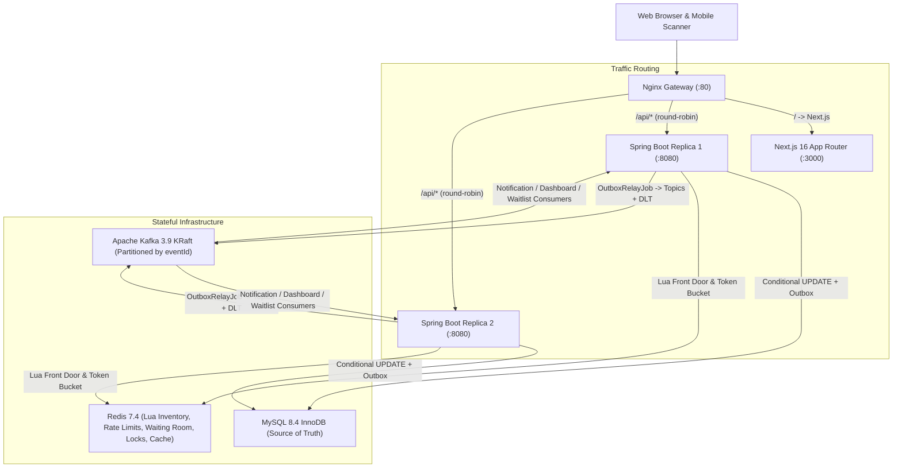
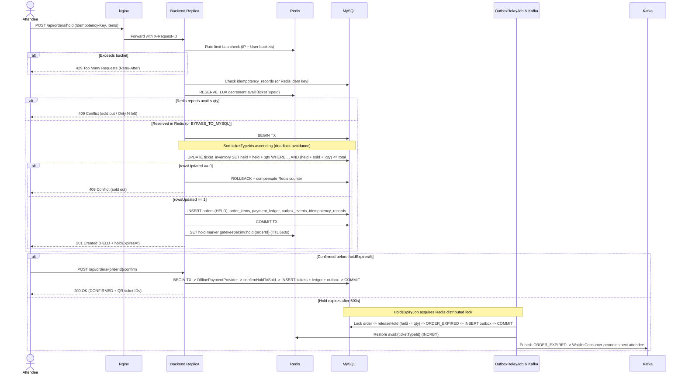
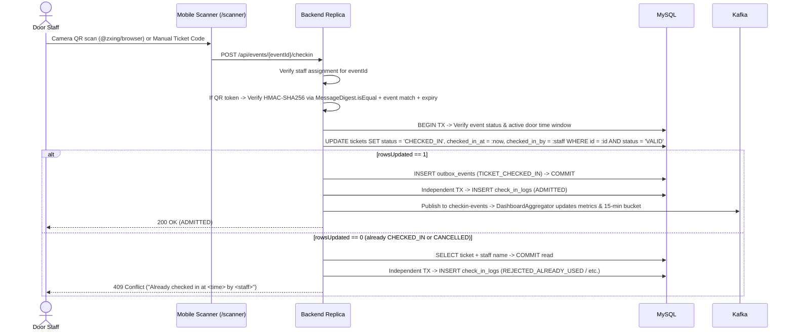
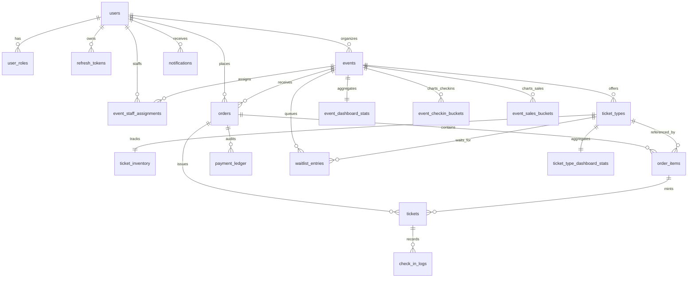

# GateKeeper Architecture

## System Overview

Nginx terminates client HTTP traffic on port `80` and round-robins `/api/*` requests across two stateless Spring Boot replicas (`backend-1` and `backend-2`), while serving `/` SSR and client bundles from the Next.js container. Both backend replicas share MySQL 8.4 (InnoDB source of truth), Redis 7.4 (atomic front-door inventory, token-bucket rate limits, virtual waiting room queues, event cache, and distributed scheduler locks), and Apache Kafka 3.9 in KRaft mode.

---

## Booking, Confirm, Ticket Issuance & Hold Expiry Sequence

---

## Door Check-In Sequence (Atomic & Idempotent Under Concurrent Scans)

---

## Relational Data Model (ER Diagram)

All public entities use UUID strings stored in MySQL as `CHAR(36) CHARACTER SET ascii COLLATE ascii_bin` (configured via `@JdbcTypeCode(SqlTypes.CHAR)`) so no sequential internal IDs leak to clients.

---

## Database Indexes & Why Each Exists

Defined in [V1__init_schema.sql](file:///Users/apple/Desktop/Antigravity/Project/backend/src/main/resources/db/migration/V1__init_schema.sql):

| Table | Index Name | Columns | Query / Invariant Served |
|---|---|---|---|
| `orders` | `idx_orders_event_status` | `(event_id, status)` | Organizer order management filtered by event and status without full table scan. |
| `orders` | `idx_orders_user_created` | `(user_id, created_at)` | Paginated `GET /api/orders` "My Orders" sorted newest-first per attendee. |
| `orders` | `idx_orders_hold_expiry` | `(status, hold_expires_at)` | `HoldExpiryJob` sweep finding timed-out `HELD` orders in index range order. |
| `orders` | `idx_orders_payment_deadline` | `(status, payment_deadline_at)` | `HoldExpiryJob` sweep expiring unpaid `PENDING_PAYMENT` orders past deadline. |
| `tickets` | `uk_tickets_code` | `(ticket_code)` `UNIQUE` | Global uniqueness guarantee and O(log N) manual ticket code lookup at door check-in. |
| `tickets` | `idx_tickets_event_status` | `(event_id, status)` | Organizer attendee/ticket roster and live door status queries per event. |
| `tickets` | `idx_tickets_user_created` | `(user_id, created_at)` | Paginated `GET /api/tickets` "My Tickets" screen sorted by issue date. |
| `tickets` | `idx_tickets_order` | `(order_id)` | Batch ticket loading during order view and atomic refund cancellation. |
| `idempotency_records` | `uk_idempotency_key` | `(idempotency_key)` `UNIQUE` | Prevents duplicate booking execution on client retries or concurrent double-clicks. |
| `ticket_inventory` | `chk_inventory_bounds` | `CHECK (held >= 0 AND sold >= 0 AND total > 0 AND (held + sold) <= total)` | Storage-engine hard guard ensuring inventory can never go negative or oversell. |
| `notifications` | `idx_notifications_user_unread` | `(user_id, is_read, created_at)` | Fast unread count badge and unread inbox retrieval without scanning historical read rows. |
| `outbox_events` | `idx_outbox_status_created` | `(status, created_at)` | `OutboxRelayJob` polling oldest unpublished `PENDING` events in chronological batch order. |
| `processed_kafka_events` | `PRIMARY KEY` | `(consumer_group, event_id)` | Idempotent Kafka consumer deduplication across independent consumer groups (`notification-consumer`, `dashboard-aggregator`, `waitlist-consumer`). |
| `waitlist_entries` | `idx_waitlist_queue` | `(ticket_type_id, status, created_at)` | Strict FIFO selection of the next `WAITING` attendee when seats return to inventory. |
| `events` | `idx_events_category_status_start` | `(category, status, start_time)` | Public catalog browsing filtered by `PUBLISHED` status, category, and date range. |

---

## Scaling to 100x

Moving from the current 2-replica Docker Compose stack (~100 req/s single-node local benchmark) to **10,000+ req/s global flash-sale scale (100x)** requires eliminating single-node bottlenecks systematically across every tier:

1. **MySQL Read Replicas (CQRS Light)**:
   - Route public catalog reads (`GET /api/events`, search, filtering), attendee history (`GET /api/orders`, `GET /api/tickets`), and organizer attendee exports to read replicas configured with `@Transactional(readOnly = true)` via a routing `DataSource`.
   - Keep booking holds, confirmations, check-ins, and outbox inserts strictly on the primary writer.
2. **Horizontal Sharding by `event_id`**:
   - Every core transactional entity (`events`, `ticket_types`, `ticket_inventory`, `orders`, `tickets`, `check_in_logs`, `outbox_events`, dashboard tables) carries `event_id` directly.
   - Partitioning databases by consistent hash of `event_id` ensures a single event's inventory updates, order creation, ticket issuance, outbox rows, and check-ins live on the same shard without distributed 2-phase commits.
   - Cross-event user views (`My Orders`, `My Tickets`, `Notifications`) are served either via a small user-index lookup service or async CQRS projections populated by Kafka.
3. **Hot-Row Inventory Striping for Mega-Events**:
   - In our local k6 run, 20 concurrent VUs hammering one `ticket_inventory` row pushed InnoDB lock wait p95 to `2s`. For arena-sized tiers (e.g., 50,000 seats in one tier), split the tier internally into `K` sub-buckets (`ticket_inventory_shards`, e.g., `K = 16` or `32`) and pick shard `hash(userId) % K` (spilling to adjacent shards on `0 rows` updated). That increases InnoDB row-lock parallelism by `K`x cleanly.
4. **Redis Cluster**:
   - Upgrade single-node Redis to a hash-slot **Redis Cluster** with hash tags on keys belonging to the same atomic Lua operation (`{eventId}` or `{ticketTypeId}`). Note that multi-item `RESERVE_LUA` across tiers of the same event must share `{eventId}` hash tags so Lua stays single-slot atomic.
   - Replicate Redis primaries to read replicas per AZ and keep `BYPASS_TO_MYSQL` resilience intact.
5. **Kafka Partition Scaling & Multi-Instance Consumer Parallelism**:
   - Topics already use `eventId` as the partition key, preserving strict per-event ordering across hold/confirm/cancel/check-in events.
   - Scale partitions per topic from `3` (`KafkaTopicConfig`) to `32–64` and run horizontal consumer worker pods so dashboard aggregation, waitlist promotion, and notification fan-out scale linearly across concurrent events.
6. **CDN & Edge Caching for Static Assets and Public Event Pages**:
   - Serve Next.js immutable `/_next/static/*` chunks and public `GET /api/events` responses (already tagged with `Cache-Control: max-age=15, public, stale-while-revalidate=30`) behind CloudFront / Cloudflare at the edge.
   - Terminate TLS and execute coarse IP rate-limiting / bot WAF rules at the CDN before traffic even touches Nginx or Spring Boot.
7. **Virtual Waiting Room Shock Absorber During Flash Sales**:
   - Already implemented in [WaitingRoomService.java](file:///Users/apple/Desktop/Antigravity/Project/backend/src/main/java/com/gatekeeper/redis/WaitingRoomService.java) using Redis Sorted Sets (`gatekeeper:wr:queue:{eventId}` and `gatekeeper:wr:active:{eventId}`) plus automatic spike detection (`gatekeeper.waiting-room.auto-spike-threshold: 1000` holds per `10s`).
   - During a 100x flash sale (e.g., 500,000 users clicking at `10:00:00`), un-admitted requests receive `428 Precondition Required` immediately with a queue token and position without opening a single MySQL connection or Hibernate session. Only `waitingRoomThreshold` concurrent admitted buyers touch MySQL inventory rows at any instant, transforming unbounded thundering-herd lock contention into steady, predictable DB throughput.

